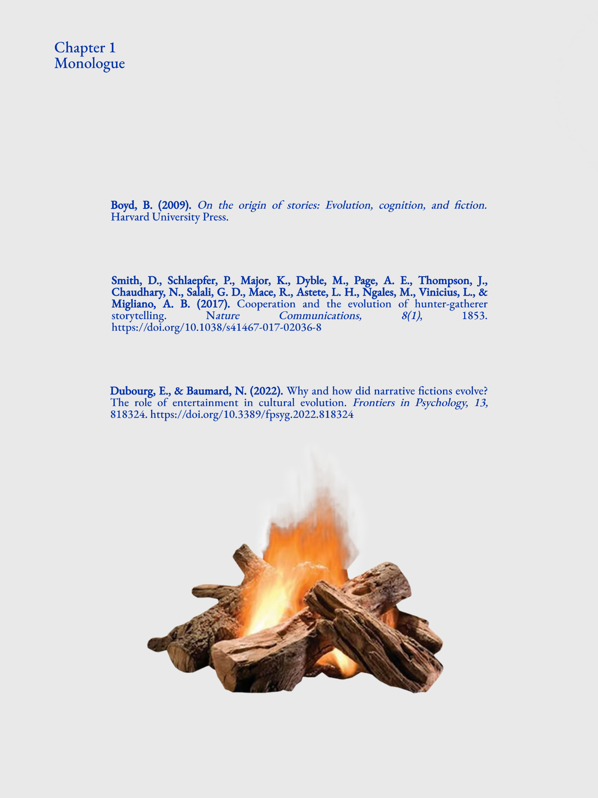
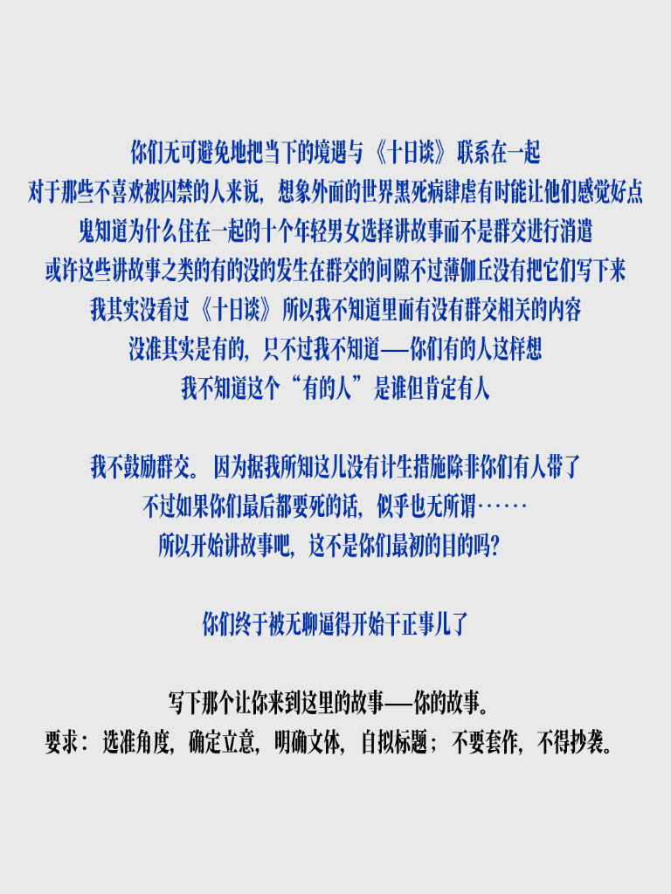

## Chapter1：██的故事

那个让你成为“你”的故事。

那个让你来到此地的故事。

独一无二，只有你能讲述的

——你的故事，你的独白

 

PS：本文与企卡内容面向的主体不同，重点也不同。你不再需要通过从上帝视角概述你的人生来介绍自己（就像简历上的那些数字与字母：GPA、MBTI、过往荣誉与工作经验时长……）专注于你的“故事”吧。人生的导演是上帝与巧合，而故事的导演是你。

	
	

